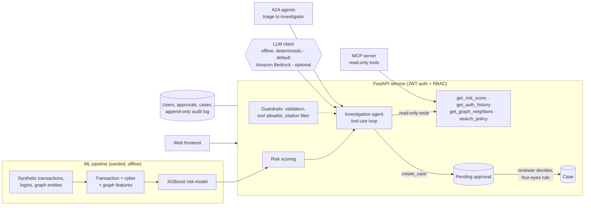

# BankShield AI

[](https://github.com/Danyy41/bankshield-ai/actions/workflows/tests.yml)

**An offline-first AI fraud-investigation platform.** Machine-learning models
score transactions using transaction, cyber-authentication and
relationship-graph signals. An AI agent investigates each alert through
controlled tools and cites the bank policy it relies on. No consequential
action happens without a human reviewer.

The whole stack runs locally and in CI with no cloud credentials. It is
reproducible end to end, containerized, and tested on every push.

## Highlights

- **ML fraud detection**: XGBoost on transaction, cyber-telemetry and
  graph features. ROC-AUC **0.937**, PR-AUC **0.572** at 1.38% fraud
  prevalence, from a leakage-safe chronological split.
- **Agentic investigation**: a tool-use loop gathers evidence (risk score,
  login history, network neighbors, policy search) and writes an
  analyst-facing narrative with verified citations (`[POL-ATO-003 §2.1]`).
- **Human-in-the-loop**: the agent can only *propose* a case. Only an
  authenticated reviewer, who isn't the requester (four-eyes rule), can
  approve it. This is enforced in code and in the database, not just in the
  prompt.
- **Security guardrails**: strict input validation, a tool allowlist, citation
  filtering against what was actually retrieved, sanitized errors, JWT auth
  with role-based access, and an append-only audit log. Validated by a
  **30-case red-team suite**.
- **Interoperable agents**: a **FastAPI** service, an **MCP server** exposing
  read-only tools, and **A2A** triage and investigation agents built on the
  official SDKs.
- **Production practices**: pinned dependencies, deterministic seeded
  pipeline, a hardened **Docker** image (non-root, read-only filesystem),
  and **GitHub Actions** CI with a reproducibility check and a container
  smoke test.

## Architecture



## Results

**Fraud detection** (10,000-transaction test set, 1.38% fraud). Each stage
adds a signal family to the same rows and hyperparameters:

| Model | Precision | Recall | ROC-AUC | PR-AUC |
|---|---|---|---|---|
| Logistic regression baseline | 0.055 | 0.710 | 0.821 | 0.136 |
| XGBoost, transaction features | 0.229 | 0.217 | 0.826 | 0.155 |
| + cyber-authentication telemetry | 0.432 | 0.645 | 0.925 | 0.551 |
| + relationship-graph features | 0.428 | 0.623 | **0.937** | **0.572** |

Precision and recall are at the default 0.5 threshold. A deployment would
tune the operating point to the cost of a missed fraud versus a false alarm.

**Investigation workflow** (offline evaluation, 10 alerts across all risk
tiers): citation correctness 1.00, evidence faithfulness 1.00, tool-call
success 1.00, about 65 ms per investigation. These measure the grounding and
citation mechanism with the deterministic offline agent, not a live LLM's
reasoning.

**Verification**, run on every push:

| Check | Result |
|---|---|
| `pytest`: unit, API, auth/RBAC, persistence, MCP, A2A, LLM client (AWS stubbed) | **315 passed** |
| Red-team suite: 30 attacks across 8 categories | **30/30 blocked** |
| Reproducibility: regenerated metrics vs. committed | **7/7 match** |
| Docker smoke test: hardened container, auth, approval gate, A2A, restart persistence | **passed** |
| MCP Inspector CLI against the MCP server | **passed** |

## Quick start

Requires Python 3.11.

```bash
python3.11 -m venv .venv && source .venv/bin/activate
pip install -r requirements-dev.txt -c requirements-lock.txt
python scripts/run_all.py                  # generate data, train models, write reports (deterministic)

export PYTHONPATH=src BANKSHIELD_JWT_SECRET="$(openssl rand -base64 48)"
python -m bankshield.auth.cli create-user alice.analyst --role analyst    # prompts for a password
python -m bankshield.auth.cli create-user rita.reviewer --role reviewer
uvicorn bankshield.api.app:app --port 8000

python -m http.server 8080 --directory frontend   # UI at http://localhost:8080
```

Run the checks locally:

```bash
pytest                                     # test suite
python scripts/run_redteam.py              # red-team suite (fails on any unblocked attack)
python scripts/check_reproducibility.py    # regenerated metrics must match the committed ones
```

**Docker** (non-root, read-only root filesystem, no capabilities, state on a
volume):

```bash
docker build -t bankshield-ai .
docker run -d --name bankshield -p 8000:8000 \
  --read-only --tmpfs /tmp --cap-drop ALL --security-opt no-new-privileges \
  -v bankshield-data:/app/var -e BANKSHIELD_JWT_SECRET="$(openssl rand -base64 48)" \
  bankshield-ai
docker exec -it bankshield python -m bankshield.auth.cli create-user alice.analyst --role analyst
scripts/docker_smoke.sh bankshield-ai      # the full smoke test CI runs
```

## How an investigation works

1. **Score**: the XGBoost model assigns a risk score and tier, with the
   top contributing features.
2. **Investigate**: the agent calls read-only tools for login history,
   network neighbors and policy passages. Every tool input is validated, and
   unknown tools are refused.
3. **Explain**: the narrative cites policy as `[DOC-ID §section]`. A citation
   is shown to the analyst only if the agent actually retrieved that passage
   in this run.
4. **Propose**: for a high-risk alert the agent calls `create_case`, which
   only files a *pending approval* attributed to the requesting analyst.
5. **Decide**: a reviewer approves or rejects. The decision and the case
   creation happen in one database transaction, at most once, and are
   recorded in the audit log.

## Interfaces

| Interface | What it offers |
|---|---|
| **REST API** (FastAPI) | `POST /auth/token`, `POST /investigations`, `GET /approvals`, `POST /approvals/{id}/decision`, `GET /cases`, transaction/risk/policy lookups, `GET /audit` (admin), `GET /health` |
| **MCP server** (`scripts/run_mcp_server.py`, stdio) | Five read-only tools (`get_transaction`, `get_risk_score`, `get_auth_history`, `get_graph_neighbors`, `search_policy`) with strict schemas. No case creation or approval tools, by design |
| **A2A agents** (`/a2a/triage`, `/a2a/investigator`) | The triage agent scores a batch of alerts and escalates Tier 1/2 alerts to the investigation agent over A2A, forwarding the caller's token. Proposals still wait for a human reviewer |
| **Web UI** (`frontend/index.html`) | Sign in, run an investigation, read the cited narrative, approve or reject |

**Roles:** `analyst` runs investigations; `reviewer` decides approvals (and
can't approve their own proposals); `admin` reads the audit log; `agent` is
for A2A service callers. Users are created only with operator access, via
the CLI.

## Testing and CI

[GitHub Actions](.github/workflows/tests.yml) runs on every push and pull
request:
1. Regenerates all data and models from the pinned lock file.
2. Runs the full `pytest` suite and the red-team suite.
3. Checks the regenerated metrics against the committed ones.
4. Checks the MCP server with the independent MCP Inspector client.
5. In a parallel job, builds the Docker image and smoke-tests it hardened,
   including a restart that must preserve users, cases and the audit trail.

Everything runs offline, with no cloud credentials.

**Reproducibility:** all generated IDs and random choices are seeded, so
every dataset and metric is byte-identical across runs on the pinned stack
(Python 3.11, `requirements-lock.txt`). Each metrics file records the
library versions that produced it.

## Tech stack

Python 3.11 · pandas · scikit-learn · XGBoost · FastAPI · Pydantic ·
SQLAlchemy · PyJWT · MCP Python SDK · A2A Python SDK · Docker · GitHub
Actions · pytest.

## Repository layout

```
src/bankshield/
  data_generation.py, features.py, ...   ML pipeline (Phases 1-3)
  investigation/   agent loop, tools, RAG over policy docs, approvals, LLM clients
  security/        validators, guardrails, red-team engine
  auth/            passwords, JWTs, roles, user CLI
  persistence/     database, audit log
  api/             FastAPI app
  agents/          A2A triage and investigation agents
  mcp_server.py    MCP server
data/policy_docs/  bank policy corpus the agent cites
security/          red-team cases and malicious-document fixtures
scripts/           pipeline steps, evaluation, red team, smoke tests
reports/           model comparisons, evaluation and red-team reports
docs/              design notes and optional integrations
```

## Limitations

- **Synthetic data.** All transactions, logins and graph entities are
  generated. The metrics describe this simulation, not real-world fraud.
- **Offline LLM by default.** The default agent client is deterministic, so
  the evaluation and red-team results measure the system's controls (tool
  gating, citation filtering, approval enforcement), not a live model's
  reasoning.
- **Security scope.** It uses a local identity store with HS256 JWTs (no
  external identity provider, no MFA). CORS is open, and TLS must be
  terminated in front of the app. SQLite allows a single writer, and A2A
  task state is per-process. Production use would need an identity
  provider, PostgreSQL and a shared task store.
- **Portfolio scope.** It hasn't been penetration-tested and isn't intended
  for real customer data.

## Optional: Amazon Bedrock

The agent can also run on Claude through Amazon Bedrock
(`BANKSHIELD_LLM_MODE=bedrock`). This is **optional, off by default, and
unverified**: the client is covered by tests that stub AWS, but no live
Bedrock inference is claimed. See [docs/bedrock.md](docs/bedrock.md).

## Further reading

- [docs/design.md](docs/design.md): detailed design notes for every phase and component
- [reports/](reports/): model comparisons, the investigation evaluation, and the red-team report

## License

Portfolio project. No license specified.
