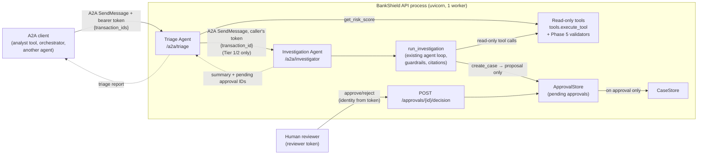
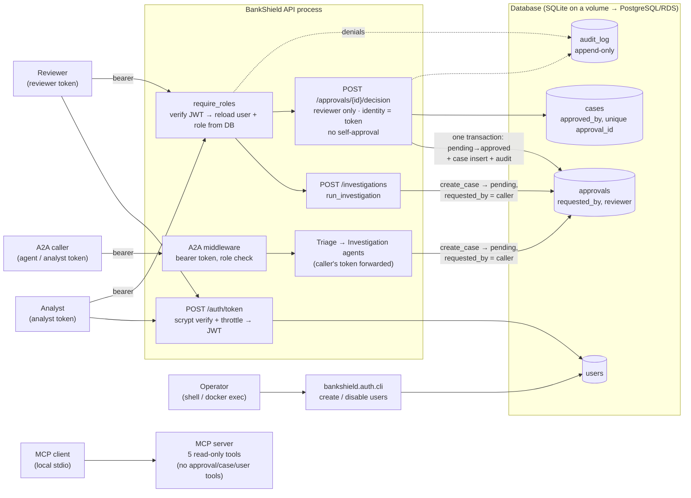

# BankShield AI

[](https://github.com/Danyy41/bankshield-ai/actions/workflows/tests.yml)

BankShield AI is a portfolio project demonstrating production-style AI engineering
across financial crime detection, cybersecurity, and applied ML. It is being built
in phases, each one a complete, working slice rather than a stub.

**This repository implements Phases 1–5, plus CI, reproducible builds, Docker, an MCP server, A2A agents, and authentication with durable state.**

## Phase 1: fraud-detection ML baseline

A clean, honest baseline: synthetic banking transaction data, careful feature
engineering, a leakage-safe train/test split, two classifiers (Logistic
Regression and XGBoost), and evaluation metrics chosen for a rare-event
classification problem rather than misleading accuracy.

No AWS, no LLMs, no RAG, no agents, no frontend yet — those are later
phases, and this project is deliberately structured so they can be added
without reworking Phase 1 (see [Roadmap](#roadmap)). Phase 1's data,
models, and metrics are untouched by Phases 2 and 3 below — this is
verified by regression tests and by re-running the full pipeline and
diffing the outputs (model file hashes and metrics JSON come out
byte-identical) after every later-phase change.

### What's in the data

`scripts/01_generate_data.py` generates ~50,000 synthetic transactions across
8,000 customers over a 120-day window (`src/bankshield/data_generation.py`).
Fraud is rare (~1.5%) and generated as a **two-stage process**:

1. Behavioural features (device used, transaction country, hour, amount,
   category, ...) are drawn from realistic population-level base rates that
   do not depend on the eventual label.
2. A fraud probability is then computed from those realized features via a
   logistic combination of risk signals — including a few genuine
   **interaction effects** (e.g. a new device used at night, or a
   cross-border transfer into a high-risk category, are riskier together
   than the sum of their individual effects) — plus Gaussian noise, and the
   label is sampled from that probability.

This makes fraud **statistically distinguishable but not trivially
separable**: every risk factor raises the fraud rate, but none of them
comes close to perfectly predicting it (verified in `tests/`).

| Field | Description |
|---|---|
| `transaction_id`, `customer_id` | identifiers |
| `timestamp` | when the transaction occurred |
| `amount` | transaction amount, category- and customer-dependent |
| `merchant_category` | e.g. grocery, travel, wire_transfer, crypto_exchange |
| `home_country`, `country`, `country_mismatch` | customer's home country vs. where the transaction happened |
| `device_id`, `new_device` | device used, and whether it's new for this customer |
| `ip_address` | transaction IP |
| `account_age_days` | age of the account at transaction time |
| `transaction_velocity_24h` | this customer's transaction count in the trailing 24h |
| `new_beneficiary` | whether a transfer/withdrawal target is new for this customer |
| `hour_of_day`, `day_of_week`, `is_night` | timing features |
| `amount_to_avg_ratio` | this transaction's amount vs. the customer's own prior average |
| `is_fraud` | target label |

Every one of these engineered features (`new_device`, `transaction_velocity_24h`,
`amount_to_avg_ratio`, ...) is computed **causally**: by walking each
customer's transactions in timestamp order and only looking at that
customer's own past. No feature ever depends on information that wouldn't
be available at the moment the transaction occurred — the first place
leakage could otherwise be introduced.

### Pipeline

```
python3.11 -m venv .venv && source .venv/bin/activate
pip install -r requirements.txt -c requirements-lock.txt   # pinned; includes fastapi/uvicorn/pydantic/boto3 for Phase 4

python scripts/run_all.py          # runs the full Phase 1 + 2 + 3 + 4 pipeline (steps 1-13)
uvicorn bankshield.api.app:app --reload --app-dir src   # serve the Phase 4 API locally
```

Or step by step (Phase 1; see [Phase 2](#phase-2-cyber-authentication-telemetry) for steps 7-9):

| Step | Script | What it does |
|---|---|---|
| 1 | `scripts/01_generate_data.py` | Generate synthetic transactions → `data/raw/transactions.csv` |
| 2 | `scripts/02_run_eda.py` | Exploratory analysis → `reports/figures/`, `reports/eda_summary.md` |
| 3 | `scripts/03_split_data.py` | Chronological train/test split → `data/processed/` |
| 4 | `scripts/04_train_baseline.py` | Train + evaluate Logistic Regression → `models/baseline_logreg_pipeline.joblib` |
| 5 | `scripts/05_train_xgboost.py` | Train + evaluate XGBoost → `models/xgboost_pipeline.joblib` |
| 6 | `scripts/06_compare_models.py` | Compare both models → `reports/model_comparison.md` |

Run the test suite (data-generation and split sanity checks) with:

```
pip install -r requirements-dev.txt -c requirements-lock.txt
pytest tests/
```

### Splitting without leakage

The train/test split is **chronological**, not a random shuffle: the
earliest 80% of transactions (by timestamp) train the model, the most
recent 20% test it. A random shuffle would let a customer's March
transaction sit in the training set while their February transaction sits
in the test set — implicitly letting the model see "the future" relative to
what it's being tested on. In production a fraud model only ever scores
transactions that happened after everything it was trained on, so the
evaluation should reflect that. It also means the same customer can
legitimately appear in both splits (their early transactions train, their
later ones test) — what never happens is the same *transaction* appearing
in both.

### Results

Test set: 10,000 transactions, 1.38% fraud prevalence.

| Model | Accuracy | Precision | Recall | F1 | ROC-AUC | PR-AUC |
|---|---|---|---|---|---|---|
| Logistic Regression (baseline) | 0.828 | 0.055 | 0.710 | 0.102 | 0.821 | 0.136 |
| XGBoost | 0.979 | 0.229 | 0.217 | 0.223 | **0.826** | **0.155** |

(Exact numbers regenerate identically on re-run — the whole pipeline is
seeded. Current values are also saved in `reports/metrics/*.json`.)

XGBoost modestly outperforms the linear baseline on both threshold-independent
metrics (ROC-AUC, PR-AUC), consistent with the data containing real
non-additive interaction effects that a linear model can only approximate.
The two models sit at very different points on the precision/recall
trade-off at their default decision threshold: `class_weight="balanced"`
pushes the logistic regression to catch 71% of fraud at the cost of very
low precision (5.5% — 1,678 false alarms to catch 98 fraud cases), while
XGBoost's more moderate `scale_pos_weight` trades some recall for far fewer
false positives. Neither is "more correct" in the abstract — the right
operating point is a business decision (cost of a missed fraud vs. cost of
a false alarm), which is why this project reports the full metric suite
and the PR/ROC curves (`reports/figures/roc_pr_comparison.png`, generated
by `scripts/06_compare_models.py`) instead of picking one number and one
threshold.

### Why accuracy alone is misleading

Fraud is rare: only 1.38% of test transactions are fraudulent. A model that
predicts "legitimate" for every single transaction — catching zero fraud —
would score **98.62% accuracy**, beating both real models trained here on
that metric alone. Accuracy weighs every prediction equally, so under this
much class imbalance it's almost entirely determined by performance on the
uninteresting 98.6% majority class. That's why this project always reports:

- **Precision** — of the transactions flagged, how many were actually fraud
  (controls false-alarm cost: blocked legitimate customers, review workload).
- **Recall** — of the actual fraud, how much was caught (the number a bank
  cares about most when limiting losses).
- **F1** — the harmonic mean of the two, useful when there's no single
  dominant business cost.
- **ROC-AUC** — ranking quality across all thresholds, but can look
  artificially strong under heavy imbalance since the false positive *rate*
  stays low even when false positives significantly outnumber true
  positives in absolute count.
- **PR-AUC** — the more honest summary metric here: a random classifier's
  PR-AUC baseline equals the fraud prevalence itself (~1.4%, not 0.5), so it
  directly reflects how hard the imbalance makes precision to achieve.
- **Confusion matrix** — the actual counts behind all of the above.

Full write-up with worked numbers: [`reports/model_comparison.md`](reports/model_comparison.md).

### Exploratory analysis

See [`reports/eda_summary.md`](reports/eda_summary.md) for class balance,
fraud rate by hour/category, and risk-factor lift numbers (e.g.
transactions with a new beneficiary are roughly 7-11x more likely to be
fraud than the baseline rate). Running `scripts/02_run_eda.py` additionally
saves plots (class balance, amount distributions, fraud rate by hour and
category, risk-factor lift, correlation matrix) to `reports/figures/`.

### Project structure

```
bankshield-ai/
├── src/bankshield/          # importable package — the actual logic
│   ├── config.py            # paths, column lists, run parameters (Phase 1 + 2 + 3 + 4)
│   ├── data_generation.py   # synthetic transaction generator (Phase 1)
│   ├── features.py          # train/test split + preprocessing pipeline
│   ├── modeling.py          # model definitions (LogReg, XGBoost)
│   ├── evaluation.py        # metrics, confusion matrix, PR/ROC plots
│   ├── eda.py                # exploratory analysis plots
│   ├── auth_generation.py   # synthetic login/session event generator (Phase 2)
│   ├── cyber_features.py    # causal login-history -> transaction feature merge (Phase 2)
│   ├── graph_generation.py  # beneficiary reconstruction + mule-ring injection (Phase 3)
│   ├── graph_features.py    # causal graph-relationship -> transaction feature merge (Phase 3)
│   ├── investigation/       # Phase 4: AI-assisted investigation
│   │   ├── schemas.py        # structured investigation payload (Pydantic)
│   │   ├── data_access.py    # read-only access to Phase 1-3 models/data
│   │   ├── policy_corpus.py  # parses data/policy_docs/ into citable chunks
│   │   ├── rag.py            # TF-IDF retrieval over the policy corpus
│   │   ├── llm_client.py     # LLMClient interface: Bedrock + offline fake
│   │   ├── bedrock_live.py   # free Bedrock preflight, redaction, live-run checks
│   │   ├── tools.py          # controlled tool registry + dispatch
│   │   ├── approvals.py      # human-approval gate for consequential actions
│   │   ├── case_store.py     # cases (created only after approval)
│   │   ├── agent.py          # tool-use loop -> cited analyst explanation
│   │   └── evaluation.py     # citation/faithfulness/cost/latency eval harness
│   └── api/
│       └── app.py            # FastAPI service layer (Phase 1-4 endpoints)
├── scripts/                 # thin, numbered, run-in-order entry points (01-06 Phase 1, 07-09 Phase 2, 10-12 Phase 3, 13 Phase 4)
├── tests/                   # data-generation, split, cyber-, graph-, and investigation-layer sanity checks
├── data/
│   ├── {raw,processed}/     # generated CSVs (gitignored, regenerate via scripts)
│   └── policy_docs/         # synthetic AML/fraud/ATO/case/KYC policy docs (versioned, Phase 4)
├── models/                  # saved joblib pipelines (gitignored, regenerate via scripts)
└── reports/
    ├── metrics/              # evaluation JSON (versioned)
    ├── figures/              # EDA + evaluation plots (gitignored, regenerate via scripts)
    └── *.md                  # EDA, model-comparison, and Phase 4 eval/architecture write-ups (versioned)
```

Preprocessing (`StandardScaler` + `OneHotEncoder`) lives inside the same
`sklearn.Pipeline` as each classifier, so `models/*.joblib` is a single
self-contained artifact — load it and call `.predict()` on a raw feature
DataFrame, no separate preprocessing step to keep in sync.

`src/bankshield`'s module boundaries (`data`, `features`, `modeling`,
`evaluation`) are intentionally where later phases will plug in — new data
sources feed `data`, new engineered signals feed `features`, new model
types feed `modeling` — without needing to restructure what's already here.

## Phase 2: cyber-authentication telemetry

Adds synthetic login/session events for the same customers and asks a
concrete question: **does knowing about login behaviour, in addition to
the transaction itself, improve fraud detection?**

### Design: correlated with fraud, without touching Phase 1

Phase 1's `is_fraud` labels are fixed and Phase 2 never modifies them —
login events are generated by *reading* the existing `transactions.csv`,
not the other way around. Every transaction gets a "pre-auth" login
session shortly before it:

- **Fraudulent transactions** are preceded by an account-takeover (ATO)
  login pattern most of the time (75%): a burst of 2-6 failed attempts
  from unfamiliar devices/countries, ending in one success from a new
  device, usually from an unusual country.
- **Legitimate transactions** almost always get a single ordinary login
  from a familiar device/country, but a small fraction (3%) still show a
  benign ATO-like burst — a mistyped password or a genuinely new phone,
  with nothing fraudulent behind it. This keeps the signal statistical,
  not a deterministic tell.
- A handful of standalone "routine" logins per customer (e.g. balance
  checks) round out the picture.

Because compromise-then-transact is the actual real-world causal order,
this produces genuine, temporally-prior signal for a model to find — not
fabricated correlation. `src/bankshield/auth_generation.py` generates the
events; `src/bankshield/cyber_features.py` aggregates each customer's
login history onto their transactions, using **only logins strictly
before the transaction's own timestamp** (verified by an exact-value
unit test in `tests/test_auth_generation.py`).

| Field | Description |
|---|---|
| `customer_id`, `timestamp` | who, when |
| `device_id`, `ip_address`, `country` | where the login came from |
| `login_success` | whether the attempt succeeded |
| `new_device`, `new_location` | unfamiliar device / country for this customer |
| `session_duration_seconds` | length of the authenticated session (0 for failed attempts) |
| `session_id` | groups a burst of attempts + outcome into one session |
| `is_ato_pattern` | generation-time diagnostic marker (never used as a model feature) |

Engineered per-transaction cyber-risk features (all causal, all prefixed
`cyber_`): `failed_logins_1h`, `login_count_24h`,
`minutes_since_last_login`, `new_device_recent`, `unusual_country_recent`,
and a composite `recent_suspicious_auth` (several recent failures *and* a
suspicious final success — the actual ATO shape, not either signal alone).

### Pipeline (continues from Phase 1)

| Step | Script | What it does |
|---|---|---|
| 7 | `scripts/07_generate_login_events.py` | Generate login events from `transactions.csv` → `data/raw/login_events.csv` |
| 8 | `scripts/08_add_cyber_features.py` | Merge cyber features onto transactions, re-split → `data/processed/train_with_cyber.csv` / `test_with_cyber.csv` |
| 9 | `scripts/09_train_compare_cyber.py` | Train transaction-only vs. transaction+cyber XGBoost, compare → `reports/phase2_comparison.md` |

Step 8 re-splits the enriched dataset with the exact same
`time_based_split` used in Phase 1, so `train_with_cyber.csv` /
`test_with_cyber.csv` contain identical rows (by `transaction_id`) to
Phase 1's `train.csv` / `test.csv` — the only difference is the appended
`cyber_*` columns. Step 9 verifies this and re-trains the transaction-only
model on those rows as a control; its metrics come out identical to
Phase 1's original numbers, confirming the comparison is apples-to-apples
and Phase 1 is unaffected.

### Results: does cyber telemetry help?

Test set: 10,000 transactions, 1.38% fraud prevalence. Both models use
identical rows, hyperparameters, and `scale_pos_weight` — the only
difference is whether `cyber_*` features are available.

| Model | Precision | Recall | F1 | ROC-AUC | PR-AUC |
|---|---|---|---|---|---|
| Transaction-only | 0.229 | 0.217 | 0.223 | 0.826 | 0.155 |
| Transaction + cyber | 0.432 | 0.645 | 0.517 | 0.925 | 0.551 |

**Yes — substantially.** PR-AUC more than triples (0.155 → 0.551), ROC-AUC
rises from 0.826 to 0.925, F1 more than doubles, and recall jumps from
22% to 64% at a comparable false-positive rate. In the trained model's
feature importances, `cyber_recent_suspicious_auth` and
`cyber_failed_logins_1h` are the top two features by a wide margin —
exactly the ATO shape the generator was designed around. Full write-up:
[`reports/phase2_comparison.md`](reports/phase2_comparison.md).

This result should be read for what it is: strong evidence that *if*
login telemetry carries an ATO signal like this, it's highly valuable —
not a claim about the exact multiplier a real deployment would see, since
the synthetic correlation strength (75% injection rate, 3% false-alarm
rate) was a deliberate design choice, not fit to real data.

### Tests

`tests/test_auth_generation.py` adds: login event schema/uniqueness,
ATO-pattern rate correlating with fraud (but staying strictly between 0
and 1 — not a trivial tell), an exact-value causality check that cyber
features never see a login that happens after the transaction, cyber
feature correlation with fraud on generated data, and a regression guard
that Phase 1's `get_X_y`/`build_preprocessor` still behave identically
when called with no arguments (both gained optional parameters for
Phase 2 but default to the original Phase 1 behavior).

## Phase 3: graph-based financial crime intelligence

Adds relationships *between* customers — shared devices, IPs, and money-
transfer beneficiaries — and asks a further question: **once a model
already has transaction and cyber-telemetry features, does knowing who's
connected to whom add anything more?**

### Design: simulating mule rings, without touching Phase 1/2

Phase 1 never persisted an actual beneficiary ID (only a `new_beneficiary`
boolean), and independently-randomized device IDs/IPs essentially never
collide by chance — so there's no organic account-to-account structure to
mine. Phase 3 builds it, in a new module (`graph_generation.py`) that only
ever reads Phase 1/2's existing, fixed data:

1. **Reconstructs beneficiary IDs** consistent with the existing
   `new_beneficiary` flag — a customer's first "new beneficiary"
   transaction gets a fresh ID, later non-new ones reuse one of their own
   prior IDs. These are new synthetic labels generated here, not values
   recovered from Phase 1's internal state (Phase 1 never stored them).
2. **Injects mule rings**: ~25 rings of 3-7 customers, membership skewed
   toward (never limited to) customers who already have a fraudulent
   transaction, each ring sharing a small pool of devices/IPs/beneficiary
   IDs across a fraction of members' transactions (biased toward their
   fraudulent ones, never all of them). Ring members end up with roughly
   an 11% fraud rate versus ~1.3% for everyone else — real, useful
   structure, not a deterministic tell.

Everything lands in new columns (`graph_device_id`, `graph_ip_address`,
`beneficiary_id`) that default to a transaction's own real device/IP — the
`device_id`/`ip_address`/`new_device` columns Phase 1/2 rely on are
untouched.

### Causal graph construction — the leakage-critical part

Phase 1/2's causal features are computed per customer in isolation
(walking one customer's own history forward in time). A graph is
different: it connects customers *to each other*, so `graph_features.py`
instead makes a **single chronological pass over all transactions**,
maintaining incremental state (who has used which device/IP/beneficiary
so far, and which customers are known to have committed fraud so far).
For every transaction, in timestamp order: compute its features from that
state, *then* fold the transaction's own device/IP/beneficiary usage and
fraud outcome into the state for the future. A transaction never sees its
own contribution or anything that happens later.

This surfaced a real bug during development: the edge-forming step
initially didn't exclude a customer's own prior usage from their "shared
with" set, so a customer reusing their own device created a false
self-loop that inflated their own neighbor count. An exact-value unit
test (`test_graph_features_no_future_leakage`) caught it before it shipped
— now checked into the test suite as a permanent regression guard.
A second, unrelated determinism bug was also caught this way: ring
membership was iterated from a Python `set`, whose order is randomized
per-process by design (`PYTHONHASHSEED`), which silently reshuffled which
random draws went to which ring member on every run. Fixed by iterating a
sorted, order-stable sequence instead — verified by regenerating twice and
diffing the output.

Features (all causal, all prefixed `graph_`): `shared_device_count`,
`shared_ip_count`, `beneficiary_connectivity` (other customers who share
this device/IP/beneficiary, before now), `suspicious_neighbor_count`
(known neighbors with prior fraud), and `account_network_risk` (fraud
rate among those neighbors).

### Pipeline (continues from Phase 1/2)

| Step | Script | What it does |
|---|---|---|
| 10 | `scripts/10_generate_graph_relationships.py` | Reconstruct beneficiary IDs, inject mule rings → `data/raw/graph_entities.csv` |
| 11 | `scripts/11_add_graph_features.py` | Merge graph features onto the cyber-enriched transactions, re-split → `train_with_graph.csv` / `test_with_graph.csv` |
| 12 | `scripts/12_train_compare_graph.py` | Train transaction+cyber vs. transaction+cyber+graph XGBoost, compare → `reports/phase3_comparison.md` |

Step 11 re-splits with the same `time_based_split` used throughout, so row
membership matches Phase 1/2's splits exactly (verified in-script, same as
Phase 2).

### Results: does graph intelligence help further?

Test set: 10,000 transactions, 1.38% fraud prevalence. Both models use
identical rows, hyperparameters, and `scale_pos_weight`.

| Model | Precision | Recall | F1 | ROC-AUC | PR-AUC |
|---|---|---|---|---|---|
| Transaction + cyber | 0.432 | 0.645 | 0.517 | 0.925 | 0.551 |
| Transaction + cyber + graph | 0.428 | 0.623 | 0.507 | **0.937** | **0.572** |

**Yes, further — modestly, and with an honest caveat.** Both
threshold-independent metrics improve (ROC-AUC +0.013, PR-AUC +0.021),
meaning the model got better at ranking fraud above legitimate
transactions. But at the fixed default 0.5 threshold, precision/recall/F1
actually dip slightly — adding features shifts the model's predicted-
probability distribution, so the cutoff tuned for transaction+cyber isn't
automatically optimal for transaction+cyber+graph. That's a threshold-
calibration artifact, not evidence against the features: a deployment
would re-tune the decision threshold before shipping either model, not
compare them at a cutoff neither was chosen for. In the trained model's
feature importances, `graph_suspicious_neighbor_count` and
`graph_shared_device_count` both place in the top 12 — real, if smaller
than cyber telemetry's, since most of the detection gain over
transaction-only was already captured in Phase 2. Full write-up:
[`reports/phase3_comparison.md`](reports/phase3_comparison.md).

### Tests

`tests/test_graph_generation.py` adds: graph-entity schema/uniqueness,
ring membership correlating with fraud without being deterministic,
exact-value beneficiary-ID reconstruction consistency, the exact-value
causal leakage test described above (including the specific case that
caught the self-loop bug — a customer reusing their own device before
anyone else touches it), graph feature correlation with fraud on
generated data, and row/column preservation checks.

## Phase 4: AI-assisted financial crime investigation

Phases 1–3 produce risk scores and features. Phase 4 turns that pipeline
into something an analyst can actually work with: a service layer that
exposes the model's outputs, an LLM-powered agent (Amazon Bedrock + Claude)
that gathers evidence through controlled tools and explains *why* an alert
fired with citations to policy, and a human-approval gate so the agent can
never take a consequential action on its own. Phase 1–3 code and data are
untouched — everything below only *reads* what those phases already
produce.

### Why this design

**A clean service layer, not a rewrite.** `src/bankshield/investigation/`
is a new package that reads Phase 1–3's trained model and CSVs through one
module (`data_access.py`) and never modifies them. Explanations for a
transaction's risk score use XGBoost's own `pred_contribs` output — exact,
per-transaction feature attribution built into the library already used —
instead of adding a `shap` dependency.

**RAG over a local TF-IDF index, not an embeddings API.** `data/policy_docs/`
holds six synthetic AML/fraud/ATO/case-management/KYC/mule-network policy
documents (`POL-XXX-NNN`, section-numbered for citation, e.g.
`POL-ATO-003 §2.1`). Retrieval (`investigation/rag.py`) uses scikit-learn's
`TfidfVectorizer` — a dependency the project already has — chunked by the
documents' own section structure rather than a fixed-size window, so a
citation reads naturally and retrieves cleanly. This keeps retrieval
deterministic and network-free, which matters twice over: the test suite
and the evaluation harness both need to run the same way every time,
without AWS credentials.

**An `LLMClient` interface, with Bedrock and a scripted offline
implementation.** `investigation/llm_client.py` defines the contract as
Amazon Bedrock's Converse API shape directly (no extra translation layer),
with two implementations: `BedrockClaudeClient` (real, via `boto3`) and
`FakeLLMClient` / `AutoFakeLLMClient` (deterministic, offline). This sandbox
has no AWS credentials, so every test and the default evaluation run
against the fake client — it is a legitimate implementation of the same
tool-use loop, not a mock, which is what lets `agent.py`'s orchestration be
exercised end-to-end in CI. Point the API at `BedrockClaudeClient()` (the
default `get_llm_client` dependency) to use the real model; see
[Running against real Bedrock](#running-against-real-bedrock).

**Six controlled tools, one of them gated.** The agent can call
`get_transaction`, `get_risk_score`, `get_auth_history`,
`get_graph_neighbors`, and `search_policy` freely — all read-only. The
sixth, `create_case`, is different: per `POL-CASE-004 §3`, naming a
customer in a case is a *consequential action*. Calling the tool never
creates anything — it files a `PendingApproval`
(`investigation/approvals.py`) and returns that pending state to the agent,
which must report it as pending, not as done. Only a separate, explicit
`POST /approvals/{id}/decision` call — a human reviewer's decision — can
turn a proposal into a `Case`. This is enforced in code (there is no
function that goes straight from a tool call to a created case), not just
requested in the system prompt.

### Structured investigation payload

`investigation/schemas.py` defines the grounding context every
investigation is built from: `TransactionRisk` (score, tier, top
contributing features with signed contributions), `CyberSignals`,
`GraphSignals`, raw `TransactionEvidence`, recent `AuthEvent`s,
`GraphNeighbor`s, and `PolicyCitation`s retrieved for the alert —
assembled into one `InvestigationPayload` before the agent's tool-use loop
even starts. The full run (payload + narrative + citations + every tool
call + any pending approval + token/cost/latency accounting) is an
`InvestigationResult`.

### API surface

`src/bankshield/api/app.py` (FastAPI):

| Endpoint | Purpose |
|---|---|
| `GET /health` | Liveness check — `{"status": "ok"}` |
| `GET /demo/sample-transactions` | 5 (or `?n=`) valid transaction_ids with risk score/tier — see [below](#trying-the-demo) |
| `GET /transactions/{id}`, `/transactions/{id}/risk` | Phase 1–3 passthrough |
| `GET /customers/{id}/auth-history`, `/graph-neighbors` | Phase 2/3 passthrough |
| `POST /policy/search` | RAG search over the policy corpus |
| `POST /investigations` | Run the agent on a transaction_id |
| `GET /investigations/{id}` | Retrieve a prior run |
| `GET /approvals`, `POST /approvals/{id}/decision` | The human-approval queue |
| `GET /cases`, `GET /cases/{id}` | Cases created only after approval |

### Trying the demo

The synthetic dataset's transaction_ids aren't documented anywhere a caller
would otherwise see them, so `GET /demo/sample-transactions` hands out a
few valid, real ones to get started against a freshly deployed instance —
by default a demo-friendly mix spread across risk tiers (up to 2 tier_1, 2
tier_2, 1 tier_3), not just whatever sorts first:

Every endpoint except `/health` needs a bearer token (see
[Security](#security-authentication-authorization-and-durable-state)):

```
TOKEN=$(curl -s -X POST http://localhost:8000/auth/token \
  -d username=alice.analyst -d password='<password>' | jq -r .access_token)

curl -H "Authorization: Bearer $TOKEN" http://localhost:8000/demo/sample-transactions
# {"transactions": [
#   {"transaction_id": "...", "risk_score": 0.986, "risk_tier": "tier_1"},
#   {"transaction_id": "...", "risk_score": 0.005, "risk_tier": "tier_3"},
#   ...
# ]}

curl http://localhost:8000/investigations -H "Authorization: Bearer $TOKEN" \
  -X POST -H 'content-type: application/json' \
  -d '{"transaction_id": "<one of the ids above>"}'
```

The underlying scan (`investigation.data_access.sample_transactions`) is
cached after its first call — tier_1 alerts are rare in this dataset (see
POL-AML-001 §2.1), so finding a couple can mean scoring a few hundred
candidates; the endpoint pays that cost once per process, not per request.

### Frontend

`frontend/index.html` is a single self-contained static page (no build
step, no framework, no npm dependency — plain HTML/CSS/JS) that drives the
API above end to end: pick one of the sample transactions, run an
investigation, and see the risk score/tier, transaction evidence, cyber
signals, graph signals, the narrative (with policy citations highlighted
inline), the cited-passage cards, and approval status — including working
Approve/Reject buttons that call `POST /approvals/{id}/decision` and
render the resulting case's approval, live. It doesn't touch or duplicate
any backend logic — every value it displays comes straight from
`InvestigationResult`.

Open it directly (`frontend/index.html`) or serve it with any static file
server:

```
python -m http.server 8080 --directory frontend
# then open http://localhost:8080
```

The **API URL** field at the top right is editable and persisted in
`localStorage` — point it at wherever the API is deployed. It defaults to
`http://localhost:8000` when opened as a local file, or the page's own
origin when served from somewhere else (e.g. mounted behind the same
reverse proxy as the API). Because the frontend runs in the browser as a
separate origin from the API by default, the API enables CORS
(`allow_origins=["*"]`) purely as transport plumbing for this — no
endpoint's behavior changes, and every consequential action is still
gated behind human approval regardless of which origin calls it.

### Analyst-facing explanations, grounded and cited

The agent's system prompt requires every factual claim to come from a tool
call (risk score before describing risk, auth history before describing
login behavior, policy search before citing policy) and every policy
citation to reference a passage it actually retrieved, formatted
`[DOC-ID §section]`. `agent.py` then filters the narrative's citations down
to ones that both exist in the corpus and were actually retrieved during
that run — a citation to a real section the agent never looked up is
dropped, not trusted.

### Deployment mode: `BANKSHIELD_LLM_MODE`

`api/app.py`'s `get_llm_client` dependency — which `LLMClient` backs
`POST /investigations` — is selected by the `BANKSHIELD_LLM_MODE`
environment variable, not a code change:

| `BANKSHIELD_LLM_MODE` | Backend | Requires |
|---|---|---|
| `offline` (default) | `AutoFakeLLMClient` — deterministic, scripted | Nothing. Safe default for a public demo deployment. |
| `bedrock` | `BedrockClaudeClient` — real Amazon Bedrock Converse API, Claude Opus 5.5 via the `us.anthropic.claude-opus-5-5` inference profile in `us-east-1` (override with `BANKSHIELD_BEDROCK_MODEL_ID` / `BANKSHIELD_BEDROCK_REGION` or `AWS_REGION`) | AWS credentials from the standard provider chain, Bedrock model access, and [`bedrock:InvokeModel`](deploy/iam/bedrock-invoke-policy.json) — see [Running against real Bedrock](#running-against-real-bedrock) |

Leaving `BANKSHIELD_LLM_MODE` unset means the deployed API serves real
requests end-to-end (transactions, risk scores, investigations, the
approval workflow) with **zero configuration and no AWS dependency** —
this is the intended default for a publicly reachable demo. `bedrock` mode
is covered by stubbed-boto3 tests (`tests/test_bedrock_client.py`) but has
**not yet been run against a live endpoint** — see the live-run status
under [Running against real Bedrock](#running-against-real-bedrock).

**Deployment commands:**

```
# Public demo (default) — offline, no AWS credentials needed
uvicorn bankshield.api.app:app --app-dir src --host 0.0.0.0 --port 8000

# Explicit offline mode (equivalent to the default)
BANKSHIELD_LLM_MODE=offline uvicorn bankshield.api.app:app --app-dir src --host 0.0.0.0 --port 8000

# Real Bedrock/Claude backend — requires AWS credentials in the environment
BANKSHIELD_LLM_MODE=bedrock uvicorn bankshield.api.app:app --app-dir src --host 0.0.0.0 --port 8000

# Local development, auto-reload
uvicorn bankshield.api.app:app --reload --app-dir src
```

An unrecognized `BANKSHIELD_LLM_MODE` value raises a clear `RuntimeError`
(`Invalid BANKSHIELD_LLM_MODE=... ; expected 'offline' or 'bedrock'.`) the
first time `get_llm_client` is resolved, rather than silently falling back
to a default. The evaluation harness has its own, independent `--live` flag
for the same offline/Bedrock choice:

```
python scripts/13_evaluate_investigations.py           # offline (default)
python scripts/13_evaluate_investigations.py --live --confirm-billable   # real Bedrock (paid)
```

### Running against real Bedrock

The same `BedrockClaudeClient` and agent loop, pointed at Amazon Bedrock.
Offline stays the default; nothing below runs unless you opt in.

**Model.** Claude Opus 5.5 is served on Bedrock only through cross-region
inference profiles — there is no in-region `anthropic.claude-opus-5-5:0`
base-model ID to call directly. The default, `us.anthropic.claude-opus-5-5`,
keeps traffic inside US regions (us-east-1 / us-east-2 / us-west-2), which
fits a bank's data-residency stance better than `global.` (which may route
anywhere, at ~10% lower cost). For other geographies set
`BANKSHIELD_BEDROCK_MODEL_ID` to `eu.`, `jp.` or `au.anthropic.claude-opus-5-5`
and a matching region.

**Credentials.** Only boto3's standard provider chain: IAM Identity Center
(`aws sso login --profile P` + `AWS_PROFILE=P`), an ECS task role or EC2
instance profile, or environment keys for short-lived credentials. Nothing
in the app accepts, stores or logs a key; Bedrock errors are logged by code
only, since AWS error text can contain account IDs and ARNs.

**Minimum IAM** — [`deploy/iam/bedrock-invoke-policy.json`](deploy/iam/bedrock-invoke-policy.json)
(replace `ACCOUNT_ID`): `bedrock:InvokeModel` on the inference profile, plus
on the `anthropic.claude-opus-5-5` foundation model *only when reached
through that profile* (`bedrock:InferenceProfileArn` condition). The
Converse API is authorized by `bedrock:InvokeModel`; no streaming, no
`bedrock:*`. The last statement (`GetInferenceProfile`,
`GetFoundationModelAvailability`) is optional and only used by the free
preflight. Model access must also be enabled for the account (Bedrock
console → Model catalog; Anthropic models need the one-time use-case form).

**Failure handling.** botocore connect/read timeouts (10 s / 120 s per
turn), adaptive retries (4 attempts total) for throttling, then every
failure becomes an `LLMServiceError` with a caller-safe message and a
category. The investigation fails closed: nothing is saved, the API returns
`503` + `Retry-After` (throttled, timed out, unavailable) or `502`
(access denied, model not found, request rejected), and A2A tasks end
`failed`. A case the agent proposed before the failure stays a *pending*
approval — still only a reviewer can turn it into a case — and its id is
returned with the error. Tools run only on a `tool_use` stop; a guardrail
intervention, content filter or malformed tool call ends the run and is
flagged in the narrative. Opus 5.5's signed reasoning blocks are passed
back verbatim between tool turns, and no sampling parameters or forced
`tool_choice` are sent (Opus 5.5 rejects both).

**1. Free preflight** (STS + Bedrock control plane, no inference):

```
AWS_PROFILE=your-profile python scripts/bedrock_preflight.py
# [ OK ] credentials valid (account ****1234, assumed-role)
# [ OK ] inference profile us.anthropic.claude-opus-5-5 is ACTIVE in us-east-1 (...)
# [ OK ] model access to anthropic.claude-opus-5-5 is enabled
```

It prints exactly what is missing (credentials, region, profile, model
access) and exits non-zero until everything is in place.

**2. One live investigation (billable, ~$0.10–0.40, at most ~$2):**

```
AWS_PROFILE=your-profile python scripts/run_live_bedrock_investigation.py --confirm-billable
```

It runs a Tier 1 alert through the unchanged agent loop on an in-memory
database, then checks: a real model answered, the tools ran without
errors, every citation resolves to a passage the agent retrieved, and any
proposed case is still only pending (no case exists). A separate reviewer
then approves it, showing the case appears only after that decision. Only
if every check passes does it save a sanitized copy (ARNs, account IDs,
access keys and request/approval IDs redacted) to
`docs/examples/live_bedrock_investigation.{md,json}`.

**If the call is denied (`AccessDeniedException`)** even though the IAM
simulator says "allowed", find out why with free, read-only calls:

```
AWS_PROFILE=your-profile python scripts/bedrock_access_diagnose.py
```

It pulls the denied call from CloudTrail (error code, AWS's message, request
ID, region) and names the cause from that message: a service control,
resource control, session or VPC-endpoint policy, a permissions boundary, a
statement that didn't match, or a Bedrock-side gate (model access/agreement,
Marketplace subscription, the Anthropic use-case form). It also re-runs the
IAM simulation with the context Bedrock actually sends: the foundation model
in *every* region the profile routes to, with `bedrock:InferenceProfileArn` and
`aws:RequestedRegion`, plus the SCP verdict. A plain simulation without that
context can't see a region-restricting SCP or a condition mismatch. Account
IDs are masked to their last four digits and SSO session names hidden.
`--reproduce-only --confirm-billable` skips those checks (for a restricted
user that can't read IAM or CloudTrail) and sends one controlled Converse
request (`maxTokens=1`, a single attempt with no retries; not billed if
denied). It prints AWS's own error, sanitized: code, HTTP status, request
ID, the message, and the denied action and resource. It then says whether
the denial is missing Marketplace subscription permissions, an IAM denial on
the inference profile or foundation model, a model-access or account-level
restriction, or another service's authorization. The live-investigation
script prints the same details when a call is denied. API and A2A callers
still only get the generic message.
There is no separate IAM action for Converse: it is authorized as
`bedrock:InvokeModel`.

**Live-run status: pending.** No live investigation has been recorded yet:
the development environment for this repo has no valid AWS credentials,
and no example output is fabricated. The example above will appear here
once the script has been run in an AWS account with access.

### Evaluation

`scripts/13_evaluate_investigations.py` runs the agent over a golden set of
transactions spread across all three risk tiers (`POL-AML-001 §2.1`) and
reports:

- **Citation correctness** — of every `[DOC-ID §section]` citation, the
  fraction that both exist in the corpus and were actually retrieved this
  run (not just present somewhere in the corpus — an ungrounded-but-real
  citation still counts as wrong).
- **Evidence faithfulness** — whether numeric/boolean claims in the
  narrative (the stated risk score, ATO-pattern claims) match the actual
  payload values.
- **Tool-call success rate** — fraction of tool calls that didn't error.
- **Latency** and **estimated cost** — wall-clock time and a list-price
  token-cost estimate per investigation.

Offline mode (default, `AutoFakeLLMClient`, no AWS credentials) is what
runs in CI and via `run_all.py`; pass `--live` to evaluate the real Bedrock
backend instead. Current offline numbers (10 investigations: 3 Tier 1,
3 Tier 2, 4 Tier 3 — the harness takes up to 4 per tier from a fixed
600-transaction candidate sample, and Tier 1/2 alerts are rare in it):

| Metric | Value |
|---|---|
| Citation correctness | 1.000 |
| Evidence faithfulness | 1.000 |
| Tool-call success rate | 1.000 |
| Mean latency | ~65 ms |

These numbers describe the scripted offline agent's self-consistency (it
always cites what it just retrieved and states the score it just looked
up) — they are a regression guard on the harness and the grounding/citation
mechanism, not a claim about a live LLM's behavior. A `--live` run against
real Bedrock is expected to score lower on citation correctness and
evidence faithfulness, since a real model can still misquote or omit a
citation despite the grounding; that gap is exactly what this harness
exists to measure. Full write-up: [`reports/phase4_eval.md`](reports/phase4_eval.md).

### Tests

`tests/test_policy_corpus_and_rag.py`, `test_data_access.py`,
`test_llm_client.py`, `test_tools_and_approvals.py`, `test_agent.py`,
`test_api.py`, and `test_evaluation.py` add: policy-document chunking and
citation-label correctness, RAG retrieval relevance, data-access causality
(auth history drill-down never surfaces a login at or after the queried
transaction's own timestamp) and neighbor-graph symmetry, the risk-score
tool's feature attribution, full tool dispatch, the human-approval gate
(a `create_case` call never creates a case directly; only an explicit
approval decision does — tested at both the tool layer and the FastAPI
layer), end-to-end agent runs on real Tier 1/2/3 transactions from the
generated dataset, citation filtering against a deliberately fabricated
citation, and the evaluation harness's determinism and aggregation. None of
this touches or reruns Phase 1–3's own tests, which continue to pass
unmodified.

### Architecture write-up

See [`reports/phase4_architecture.md`](reports/phase4_architecture.md) for
a fuller discussion of the design decisions above, including the tradeoffs
deliberately deferred (a production vector DB and embeddings backend for
RAG, a durable approval/case store instead of in-memory — the latter
since delivered, see
[Security](#security-authentication-authorization-and-durable-state)).

## Phase 5 — AI Security Red Team

A defensive security layer (`src/bankshield/security/`) built around the
Phase 4 investigation agent, plus a deterministic, offline red-team suite
that attacks it. Phase 1–4 logic is untouched except for three small,
targeted fixes the red-teaming itself surfaced (below) — the human-approval
gate, tool allowlist, and offline architecture are exactly as before.

### Attack categories (30 cases, `security/redteam_cases.yaml`)

1. **Prompt injection** — narrative claims of already-completed actions,
   instruction-shaped API field values, injected enum values.
2. **RAG / document poisoning** — a synthetic malicious policy document
   (`security/malicious_policy_fixtures/`), kept structurally isolated from
   the production corpus, tested both for accidental ingestion and for
   whether its content — if retrieved — could authorize a consequential
   action.
3. **Unauthorized tool use** — tool names outside the allowlist, near-miss
   name variants, direct (agent-loop-bypassing) tool calls.
4. **Human approval bypass** — blank reviewer, double-decision, a forged
   non-approved approval object handed straight to the case store.
5. **Citation integrity** — nonexistent citations, real-but-unretrieved
   citations, malformed citation shapes.
6. **Sensitive-data / information leakage** — direct requests for the
   system prompt/credentials via `search_policy`, injection-style customer
   IDs, a simulated internal exception with sensitive-looking text.
7. **Adversarial API inputs** — oversized IDs, malformed JSON bodies,
   nonexistent object IDs across every lookup endpoint.
8. **Tool argument validation / privilege escalation** — smuggled extra
   fields, out-of-range numeric arguments.

Each case is *executed*, not just declared: `security/redteam_cases.yaml`
holds the human-readable metadata (threat, test case, expected behavior,
mitigation); `src/bankshield/security/redteam_engine.py` has one Python
handler per case that actually runs it against the real agent, tools, API,
and RAG stack — offline, via `FakeLLMClient`/`AutoFakeLLMClient`, no AWS
credentials, no live model. Where a case needs to simulate a compromised or
jailbroken model, the script emits exactly the tool call or narrative text
such a model would produce, and checks whether the *system* — not the
model's judgment — still holds.

### Defenses (`src/bankshield/security/`)

- **`validators.py`** — a Pydantic model per tool (`extra="forbid"`,
  bounded string lengths, enum-constrained fields like `create_case`'s
  `disposition`), enforced server-side in `tools.execute_tool` before
  dispatch. This is a structural allowlist/schema check, not a keyword
  filter: it rejects anything that doesn't match the declared shape,
  regardless of what the strings inside it say.
- **`guardrails.py`** —
  - `safe_execute_tool`: fail-closed containment around tool execution. An
    unknown/disallowed tool name still raises inside `tools.py` (that
    tested contract is untouched); this wrapper is the agent loop's
    boundary, turning that exception into a contained error result instead
    of crashing the investigation.
  - `filter_citations_to_retrieved` / `retrieved_chunk_ids`: a citation is
    only trusted if it was *actually retrieved this run* (the automatic
    grounding search or an explicit `search_policy` call) — not merely
    because a chunk with that ID happens to exist in the corpus. This
    closes a real gap found during Phase 5 inspection: the original
    `agent.py` citation check only verified existence, so a narrative could
    cite a real-but-never-looked-up policy section and have it pass as
    "verified."
  - `sanitize_error_response`: backs a global FastAPI exception handler —
    any unexpected exception becomes a fixed, generic 500 message, never
    the original exception text (which could contain file paths or other
    internal detail).
- **Pre-existing, unchanged boundary**: `create_case` never creates a
  `Case` — it only ever files a `PendingApproval`. A `Case` is constructed
  exclusively inside `CaseStore.create_from_approval`, reachable only from
  `ApprovalStore.decide(approved=True)`, itself only reachable from the
  human-facing `POST /approvals/{id}/decision` endpoint. No LLM output,
  retrieved document, or tool request can reach a `Case` directly. Phase 5
  adds one defense-in-depth assertion (`create_from_approval` now also
  checks `approval.status == APPROVED`) without changing this boundary.
- **Bounded API inputs**: every request body field and path parameter that
  identifies an object now has an explicit length bound
  (`security.validators.MAX_ID_LEN` etc.), and `ApprovalDecisionRequest`
  rejects an empty `reviewer`. (Since the security step, the reviewer is
  the authenticated principal; a body `reviewer` naming anyone else is
  refused — see APR-04…08.)

### Results

**30/30 synthetic attacks blocked (100%)** on the run backing
[`reports/phase5_redteam_report.md`](reports/phase5_redteam_report.md) —
run it yourself with `python scripts/run_redteam.py`. One real gap was
found and fixed during this phase (the citation-retrieval-scoping issue
above, case `CITE-02`); every other case passed against the existing
Phase 1–4 structure without modification.

```
python scripts/run_redteam.py
# [PASS] PI-01    prompt_injection
# ...
# 30/30 attacks blocked (100%)
# Saved report to reports/phase5_redteam_report.md
```

Security regression tests (`tests/test_security_redteam.py`,
`tests/test_security_validators_guardrails.py`) run the same 30 cases plus
direct unit tests of `validators.py`/`guardrails.py` as part of the normal
test suite, so a future change that reopens one of these gaps fails CI, not
just the standalone script.

### Limitations

This is a **synthetic, portfolio-scope security evaluation**, not proof of
production security:

- Every prompt-injection/RAG-poisoning case runs against a deterministic,
  scripted `FakeLLMClient` — there's no live-model evaluation here. The
  cases test whether the *system* survives a compromised model, not
  whether a real Claude model can be socially engineered by clever wording
  (that needs a live Bedrock evaluation, out of scope for this
  credential-free repo).
- ~~No authentication/authorization layer; in-memory stores~~ — addressed
  by the security step: authenticated, role-checked reviewers and durable
  stores, with six added cases (APR-04…APR-08, ARG-04) covering them. The
  suite now has 30 cases.
- No network-level threat modeling (TLS termination, WAF, rate limiting
  beyond login throttling) — deployment concerns outside this repo.
- The deterministic cases target specific, previously-identified failure
  modes; this is not exhaustive fuzzing.
- RAG defenses are structural (retrieval provenance), not semantic — the
  system doesn't classify document *content* as malicious, by design
  (avoiding brittle keyword filtering); it only denies documents any
  authority over side effects.

Full write-up, per-case table, and the complete limitations discussion:
[`reports/phase5_redteam_report.md`](reports/phase5_redteam_report.md).

## Docker

The [`Dockerfile`](Dockerfile) packages the Phase 4 API
(`bankshield.api.app:app`) as a self-contained image:

- **Reproducible artifacts.** A builder stage installs the pinned stack
  (`requirements.txt` + `requirements-lock.txt`) and runs the seeded
  Phase 1–3 pipeline steps the API needs; the runtime stage copies in only
  their outputs (graph-enriched transactions, login events, graph
  entities, the XGBoost+graph model) plus the policy corpus. The pipeline is
  deterministic, so every build serves the same data and model as the
  committed reports. The build fails if those artifacts can't be loaded
  and scored.
- **Offline by default.** `BANKSHIELD_LLM_MODE=offline` (the scripted
  `AutoFakeLLMClient`) — no AWS credentials needed. Set
  `-e BANKSHIELD_LLM_MODE=bedrock` plus credentials from the standard chain
  (on ECS, a task role — never keys baked into the image) to use the real
  model; see [Running against real Bedrock](#running-against-real-bedrock).
- **Hardened.** Python 3.11 slim base pinned by digest, non-root user
  (uid 10001), no build tools in the runtime image, and it runs under a
  read-only root filesystem with all capabilities dropped. A `HEALTHCHECK`
  polls `GET /health`.
- **Durable state on a volume.** Users, approvals, cases, investigation
  results and the audit log live in SQLite at `/app/var` — the only
  writable path besides `/tmp` — so mount a volume there. The JWT signing
  key is supplied at run time, never baked in. One uvicorn worker by
  default (A2A task state and the login throttle are per-process); point
  `BANKSHIELD_DATABASE_URL` at PostgreSQL to scale out.

```
docker build -t bankshield-ai .
docker volume create bankshield-data
docker run -d --name bankshield -p 8000:8000 \
  --read-only --tmpfs /tmp --cap-drop ALL --security-opt no-new-privileges \
  -v bankshield-data:/app/var \
  -e BANKSHIELD_JWT_SECRET="$(openssl rand -base64 48)" \
  bankshield-ai

# Accounts are created with operator access only (no HTTP endpoint for it):
docker exec -it bankshield python -m bankshield.auth.cli create-user alice.analyst --role analyst
docker exec -it bankshield python -m bankshield.auth.cli create-user rita.reviewer --role reviewer

curl http://localhost:8000/health                      # {"status":"ok"}
scripts/docker_smoke.sh bankshield-ai                  # full hardened smoke test + restart check (what CI runs)
```

`docker ps` shows the container as `healthy` once the health check
passes. Behind a TLS-intercepting proxy, give pip its CA bundle as a build
secret (it is never stored in an image layer):
`docker build --secret id=pip_cert,src=/path/to/ca-bundle.crt -t bankshield-ai .`

The image holds synthetic data only. Every non-public endpoint requires a
token, but CORS is open (`*`) and TLS is expected to be terminated in front
of the container (load balancer / API gateway) — configure both before
exposing it beyond a trusted network.

## MCP server

[`src/bankshield/mcp_server.py`](src/bankshield/mcp_server.py) exposes the
investigation agent's **read-only** tools over the
[Model Context Protocol](https://modelcontextprotocol.io), so any MCP client
(Claude Code, Claude Desktop, MCP Inspector, your own agent) can query
BankShield's data, model, and policy corpus. It is built on the official MCP
Python SDK (`mcp`, low-level `Server`) and reuses the existing tool layer
rather than re-declaring it:

| Tool | What it returns |
|---|---|
| `get_transaction` | Raw facts for one transaction (amount, merchant, country, device, IP, timing, amount vs. customer average) |
| `get_risk_score` | Model risk score (0–1), risk tier, and top signed feature attributions |
| `get_auth_history` | A customer's recent logins/sessions, newest first (`limit` 1–200) |
| `get_graph_neighbors` | Customers linked via shared device/IP/beneficiary, with prior-fraud flags |
| `search_policy` | Citable policy passages (`DOC-ID §section`) for a query (`top_k` 1–20) |

- **Same validation as the agent.** Each call goes through
  `tools.execute_tool`, so the Phase 5 validators
  (`security/validators.py`) enforce the schema server-side: unknown
  fields, wrong types, oversized strings, and out-of-range limits are
  rejected. Discovery advertises those same strict schemas
  (`additionalProperties: false`, length/range bounds), and every tool is
  annotated `readOnlyHint: true`. Unexpected errors are sanitized by
  `guardrails.sanitize_error_response` — internals are logged to stderr,
  never returned.
- **No case creation over MCP — by design.** `create_case` is not exposed,
  and neither is any approval decision. Approvals and cases live in the
  HTTP API process's memory, so a proposal filed by a separate MCP process
  could never reach a human reviewer; and deciding an approval is the
  human half of the POL-CASE-004 §3 gate, which an (often AI) MCP caller
  must not hold. Exposure is an explicit allowlist checked at import
  against `tools.CONSEQUENTIAL_TOOLS`; a call to any other tool name is
  refused before it reaches the dispatcher. Case proposals stay on the
  API's `POST /investigations` → `POST /approvals/{id}/decision` path.

### Launch and connect

The server speaks MCP over **stdio**, launched by the client. It needs the
generated data and model (`python scripts/run_all.py`) and loads them at
startup — if they're missing it exits with a clear error on stderr.

```
# Claude Code
claude mcp add bankshield -- /abs/path/to/.venv/bin/python /abs/path/to/bankshield-ai/scripts/run_mcp_server.py

# MCP Inspector (interactive UI, or --cli for scripted calls)
npx @modelcontextprotocol/inspector@2.9.0 python scripts/run_mcp_server.py
npx @modelcontextprotocol/inspector@2.9.0 --cli python scripts/run_mcp_server.py --method tools/list
```

Claude Desktop (`claude_desktop_config.json`):

```json
{
  "mcpServers": {
    "bankshield": {
      "command": "/abs/path/to/.venv/bin/python",
      "args": ["/abs/path/to/bankshield-ai/scripts/run_mcp_server.py"]
    }
  }
}
```

Or run it from the Docker image, which already contains the data and model
(`-i` keeps stdin open for the protocol):

```
docker run -i --rm --read-only --tmpfs /tmp --cap-drop ALL bankshield-ai python -m bankshield.mcp_server
```

### Tests

`tests/test_mcp_server.py` drives the server through the official MCP SDK
client — in-process, and end to end over a real stdio subprocess — covering
discovery (exactly the five tools, read-only annotations, strict schemas),
a valid call to every tool, invalid inputs (missing/wrong-type/oversized/
extra fields, out-of-range limits), and security boundaries (`create_case`
and look-alike names refused with no approval filed and no case created;
no exposed tool touches the approval gate; internal errors sanitized). CI
also runs [`scripts/check_mcp_inspector.sh`](scripts/check_mcp_inspector.sh),
which exercises the server with an independent client — the MCP Inspector
CLI (TypeScript SDK).

### Limitations

- **No authentication (local stdio).** The server runs with the privileges
  of whoever launches it, and anyone who can launch it can read the
  (synthetic) data the tools expose. It has no tool that touches approvals,
  cases, users or identities, so it can't decide an approval or act as a
  reviewer even with full access to its own process. No network transport
  is provided on purpose: one would need the API's token checks first.
- **No per-caller scoping or rate limiting.** Any connected client can
  query any transaction or customer. Fine for synthetic data; real data
  would need entitlement checks and audit logging per caller.
- **Tool output is untrusted text for the client.** `search_policy`
  returns policy text verbatim; the corpus is fixed and the malicious
  fixtures live outside it (Phase 5), but an MCP client's model should
  still treat tool results as data, not instructions.

## A2A multi-agent architecture

Two agents built on the official A2A Python SDK (`a2a-sdk`) and served over
the [Agent2Agent protocol](https://a2a-protocol.org) (JSON-RPC binding,
A2A 1.0): a **Triage Agent** that scores a batch of alerts and an
**Investigation Agent** that investigates one alert. The triage agent is an
A2A *client* of the investigation agent — it discovers it through its agent
card and calls it with `SendMessage`, exactly as any external A2A client
would.



| Agent | Endpoint / agent card | Input (one JSON data part) | Does |
|---|---|---|---|
| Triage | `POST /a2a/triage`, `GET /a2a/triage/.well-known/agent-card.json` | `{"transaction_ids": [...]}` (1–20) | Scores each alert with `get_risk_score`, applies the POL-AML-001 §2.1 tiers, escalates Tier 1/2 to the Investigation Agent over A2A, records Tier 3 as monitored, returns a triage report |
| Investigation | `POST /a2a/investigator`, `GET /a2a/investigator/.well-known/agent-card.json` | `{"transaction_id": "..."}` | Runs the existing investigation loop (`run_investigation`) and returns its disposition, verified citations, tools used, and any **pending** case proposals |

**Reuse, not rewrite.** The investigation agent wraps
`investigation.agent.run_investigation` unchanged, so it keeps the
existing guardrails (`safe_execute_tool`, retrieval-scoped citations, the
Phase 5 validators). The triage agent calls the same `tools.execute_tool`
with a read-only allowlist. Both agents are mounted on the existing FastAPI
app (`src/bankshield/agents/server.py`), and the offline/Bedrock switch
(`BANKSHIELD_LLM_MODE`) applies to the investigation agent too.

### The human-approval gate holds

- **Agents can propose, never approve.** The investigation agent's only
  consequential path is the existing `create_case` tool, which files a
  `PendingApproval` and nothing else. Neither agent has any code path to
  `ApprovalStore.decide` or `CaseStore`; a case exists only after an
  authenticated reviewer calls `POST /approvals/{approval_id}/decision`.
  Agents run with the caller's own token (the triage agent forwards it), and
  `agent`-role service accounts are refused by the decision endpoint. Reports carry
  `human_action_required` and the pending approval IDs, and the full
  investigation is viewable at `GET /investigations/{transaction_id}`.
- **Same process, same queue.** The agents run inside the API process, so a
  proposal lands in the exact `ApprovalStore` the decision endpoint reads
  (now durable — see Security).
- **Inbound A2A messages are untrusted input.** Each agent accepts exactly
  one user-role JSON data part matching a strict schema (`extra="forbid"`,
  bounded lengths, batch ≤ 20). Free-text parts, extra parts, and smuggled
  fields such as `approved` / `reviewer` / `auto_approve` are rejected
  (`TASK_STATE_REJECTED`) before any agent logic runs, so an instruction in
  a message can never reach the agents as anything but a validated ID.
- **Agents treat each other's output as data.** The triage agent validates
  every investigation reply against a strict schema and drops anything of
  an unexpected shape.
- **Errors fail closed.** Unknown IDs fail the task with a not-found
  message; unexpected exceptions are reduced to a generic message by
  `guardrails.sanitize_error_response`.

### Try it

```
uvicorn bankshield.api.app:app --app-dir src     # or the Docker image

curl http://localhost:8000/a2a/triage/.well-known/agent-card.json

curl -X POST http://localhost:8000/a2a/triage -H "Authorization: Bearer $TOKEN" \
  -H 'Content-Type: application/json' -H 'A2A-Version: 1.0' \
  -d '{"jsonrpc": "2.0", "id": "1", "method": "SendMessage",
       "params": {"message": {"messageId": "m1", "role": "ROLE_USER",
         "parts": [{"data": {"transaction_ids": ["849e00a5ee8c483ba5751e12007432b0"]}}]}}}'
# -> a completed task whose artifact is the triage report; any
#    pending_approval_ids still need POST /approvals/{id}/decision.
```

The agents advertise, and the triage agent dials, `BANKSHIELD_A2A_BASE_URL`
(default `http://127.0.0.1:8000`); set it to the public URL when deploying
behind a proxy or on another port.

### Tests

`tests/test_a2a_agents.py` drives both agents with the official A2A SDK
client: agent-card discovery; a Tier 1 investigation that proposes but
never creates a case; a Tier 3 investigation that proposes nothing; a
triage batch that escalates Tier 1, monitors Tier 3, and reports a missing
ID; ten malformed/adversarial messages rejected with the gate untouched;
sanitized internal errors; a tampered investigation reply that triage
refuses; an instrumented run proving the multi-agent flow never calls
`ApprovalStore.decide` or `CaseStore.create_from_approval` (and that the
human HTTP decision then does); and an end-to-end run against a real
uvicorn server where the two agents talk over the network. The Docker
smoke test (`scripts/smoke_test_api.py`) repeats the triage → investigation
→ human-approval flow over raw JSON-RPC against the built image.

### Limitations

- ~~No authentication; in-memory state~~ — addressed by the security step:
  A2A calls need a bearer token (analyst, agent or admin; declared on the
  agent cards), decisions need an authenticated reviewer, and approvals and
  cases are durable.
- **A2A task state is still in memory** (`InMemoryTaskStore`): completed
  tasks can't be fetched with `GetTask` after a restart. The *results* that
  matter — proposals, approvals, cases, investigation results — are durable.
- **Synchronous calls only.** No streaming or push notifications; the
  triage agent investigates escalated alerts one at a time (fine for the
  1–20 alert batches it accepts).

## Security: authentication, authorization, and durable state

Every human and agent action now goes through an authenticated identity
with a role, and the approval gate's state is durable.



### Architecture decisions

| Decision | Why |
|---|---|
| **JWT bearer tokens (HS256, PyJWT), 30-min expiry**, issued by `POST /auth/token` (OAuth2 password flow) | Standard, stateless, works for the browser frontend, scripts, and A2A callers alike. Verification pins the algorithm (no `alg: none` or algorithm confusion) and requires `exp`/`iat`/`sub`/issuer/audience. The token module is the one seam to swap for a managed IdP (Amazon Cognito / OIDC, RS256 via JWKS). |
| **Role re-read from the database on every request** | The token's role is only a hint. Disabling a user or changing their role takes effect on their very next request, not at token expiry. |
| **scrypt password hashes** (stdlib `hashlib`), per-hash salt and cost parameters, constant-time compare, dummy hash for unknown users, 5-failure lockout | Memory-hard against offline cracking; login timing doesn't reveal which usernames exist; online guessing is throttled. No new dependency. |
| **Four roles** — `analyst`, `reviewer`, `admin`, `agent` | Least privilege. Only `reviewer` can decide approvals — not `admin`, not `agent`. `agent` (service accounts) can call the A2A agents and read data but can't run HTTP investigations or decide anything. Only `admin` can read the audit log. |
| **Reviewer identity comes from the token, never the body** | The old free-text `reviewer` field let anyone attribute a decision to anyone. It is now optional; if sent it must name the caller (else 403, audited). |
| **Four-eyes rule in the store** | Proposals record `requested_by` (the authenticated caller, carried in a context variable down to the `create_case` tool). `ApprovalStore.decide` refuses `reviewer == requested_by`, for every caller path, not just HTTP. |
| **SQLAlchemy Core + SQLite by default, PostgreSQL-ready** | Zero setup locally and in Docker (a volume at `/app/var`); the schema uses only portable types, so RDS/Aurora is a URL change (`BANKSHIELD_DATABASE_URL`) plus a driver. |
| **Decision + case creation in one transaction**, guarded by a conditional `UPDATE … WHERE status='pending'` and a unique `cases.approval_id` | An approval is decided at most once and its case exists exactly when it's approved — even with concurrent reviewers or multiple API processes. Case creation is driven by the stored action, not an in-memory callback, so it works after a restart. |
| **Append-only audit log** in the same transactions as the changes it records | Logins (ok / failed / locked), approval requests, decisions, case creation, and authorization denials. Admin-readable at `GET /audit`. |
| **A2A: bearer token required; the triage agent forwards the caller's token** | Agents never act with more authority than their caller, and proposals they produce are attributed to that caller. Agent cards declare the bearer scheme (`securitySchemes`). |
| **No HTTP endpoint for user management** | Accounts are created/disabled with `python -m bankshield.auth.cli` (shell or `docker exec`). Nothing that can only call the API — an MCP client, an A2A agent, a stolen token — can create a reviewer. |

### What MCP and A2A agents can't do

- **Decide or approve:** the decision endpoint accepts only the `reviewer`
  role; agent service accounts get 403. The MCP server has no approval, case
  or user tools at all.
- **Impersonate a reviewer:** decisions are attributed to the token's
  subject; a body `reviewer` naming anyone else gets 403. Tokens can't be
  forged without the signing key, and a reviewer can't approve a proposal
  they requested.
- **Escalate through each other:** the triage agent calls the investigation
  agent with the caller's own token, so a chain of agents never gains a role
  its caller lacks.

### Configuration

| Variable | Default | Notes |
|---|---|---|
| `BANKSHIELD_DATABASE_URL` | `sqlite:///var/bankshield.db` (repo), `sqlite:////app/var/bankshield.db` (image) | Any SQLAlchemy URL, e.g. `postgresql+psycopg://…` |
| `BANKSHIELD_JWT_SECRET` | random per process (warning logged) | ≥ 32 bytes. Set it in any real deployment (e.g. from AWS Secrets Manager) or tokens die on restart |
| `BANKSHIELD_TOKEN_TTL_MINUTES` | `30` | Access-token lifetime |

```
python -m bankshield.auth.cli create-user rita.reviewer --role reviewer    # prompts for a password (min 12 chars)
python -m bankshield.auth.cli disable-user rita.reviewer                     # revokes access immediately
python -m bankshield.auth.cli list-users
```

The frontend has a sign-in box; the token lives in `sessionStorage` (gone
when the tab closes), and Approve/Reject is attributed to whoever is signed
in.

### Tests

- `tests/test_auth.py` (43): login, wrong/unknown credentials, lockout,
  password hashing; 401 on every protected endpoint without a token;
  garbage, `alg: none`, wrong-key, expired, wrong-issuer/audience and
  unknown-user tokens rejected; disabling a user or changing their role
  revokes an existing token immediately; the role matrix (only reviewers
  decide, only admins read the audit log, agents can't run HTTP
  investigations); denials audited; decisions attributed to the token;
  impersonation and self-approval refused; the provisioning CLI.
- `tests/test_persistence.py` (6): a pending approval survives a restart
  and creates its case when approved afterwards; rejection never creates a
  case; eight concurrent deciders on separate engines → exactly one wins and
  one case exists; a self-approval is refused and audited; a forged
  "approved" object can't create a case on the shared database; and a
  **real uvicorn process stopped and restarted twice** keeps the pending
  approval, the investigation, the reviewer's token, the case, and the audit
  trail.
- `tests/test_a2a_agents.py` adds token delegation (proposals attributed to
  the A2A caller) and 401/403 for unauthenticated/under-privileged agent
  calls.
- Red team: six new cases (APR-04…APR-08, ARG-04) — 30/30 blocked.
- CI's Docker job (`scripts/docker_smoke.sh`) runs the image hardened with a
  volume, provisions accounts via the CLI, exercises auth/RBAC/the gate/A2A,
  restarts the container, and checks that the state persisted.

### Limitations

- **Local identity store.** Users and passwords live in BankShield's
  database. A production deployment should federate to a managed identity
  provider with MFA (Cognito/OIDC) — the token module is the seam for that.
- **HS256 shared secret.** Anyone holding `BANKSHIELD_JWT_SECRET` can mint
  tokens; keep it in a secrets manager and rotate it (rotation logs everyone
  out). Asymmetric keys come with an IdP.
- **No token revocation list.** Disabling a user revokes their tokens
  immediately (users are re-read per request), but a single token can't be
  revoked on its own before it expires (30 minutes by default).
- **Per-process login throttle and A2A task store.** Fine for one worker;
  multiple instances need them in the shared database or the IdP.
- **Schema migrations.** Tables are created with `create_all`; schema
  changes beyond additive ones need Alembic.

## Continuous integration

[`.github/workflows/tests.yml`](.github/workflows/tests.yml) runs on every
push and pull request (Python 3.11, pip-cached): it runs
`python scripts/run_all.py` to regenerate the gitignored data and models
the tests depend on, then the full `pytest` suite, then
`python scripts/run_redteam.py`, which exits non-zero if any red-team
attack is not blocked, then `python scripts/check_reproducibility.py`
(see below). Dependencies are installed from `requirements-lock.txt`.
The MCP server is checked by its pytest suite and by
`scripts/check_mcp_inspector.sh` (MCP Inspector CLI over stdio).
A parallel `docker` job builds the image and runs `scripts/docker_smoke.sh`:
the container starts with a read-only root filesystem, no capabilities and
its state on a volume; accounts are provisioned through the CLI; then
`scripts/smoke_test_api.py` checks authentication, RBAC, the approval gate
and the A2A triage → investigation flow over raw JSON-RPC; finally the
container is restarted and the persisted cases and audit trail are verified.
Everything runs offline — no AWS credentials. The JUnit results,
regenerated reports/metrics, and the resolved dependency versions
(`pip-freeze.txt`) are uploaded as a build artifact.

## Reproducibility

The pipeline is deterministic end to end: on the pinned stack, every
generated CSV and every committed metric is byte-identical from run to run
and across processes (only Phase 4 wall-clock latency varies).

- **Pinned dependencies.** `requirements.txt` pins direct dependencies
  exactly; `requirements-lock.txt` pins the full transitive set for the
  reference environment (Python 3.11, Linux x86_64 — what CI uses). Install
  with `pip install -r requirements-dev.txt -c requirements-lock.txt`.
  Model metrics *do* move across library versions (e.g. a newer XGBoost
  builds slightly different trees), which is why the stack is pinned.
- **Seeded IDs.** All generated IDs (transactions, logins, sessions,
  devices, beneficiaries) come from a seeded factory
  (`src/bankshield/ids.py`) instead of `uuid.uuid4()`, and random picks from
  sets go through `sorted()` so they don't depend on per-process string
  hashing. Runtime case/approval IDs stay truly random on purpose.
- **Recorded environment.** Every `reports/metrics/*.json` carries an
  `environment` block (Python version, platform, and the versions of
  numpy, pandas, scikit-learn, scipy, xgboost, and Faker) so each committed
  number is traceable to the stack that produced it.
- **Checked in CI.** `scripts/check_reproducibility.py` compares the
  regenerated metrics against the committed ones (ignoring the
  `environment` block and latency) and fails on any difference — so a code
  or dependency change can't silently move the numbers. After an
  intentional change, rerun `python scripts/run_all.py` and commit the
  regenerated `reports/`.

## Roadmap

Phases 1 through 5 (this repo) are the classical ML + cyber-telemetry +
graph-intelligence foundation, the AI-assisted investigation layer on top
of it, and a defensive red-team evaluation of that layer. Possible next
steps: a live-model (Bedrock) red-team run to complement the offline suite
above. The durable approval/case store and the authentication layer are
now in place (see Security); next would be a managed identity provider
(Cognito/OIDC), PostgreSQL with Alembic migrations, and a shared A2A task
store so the agents can run as separate services.

## License

Portfolio project — no license specified.
